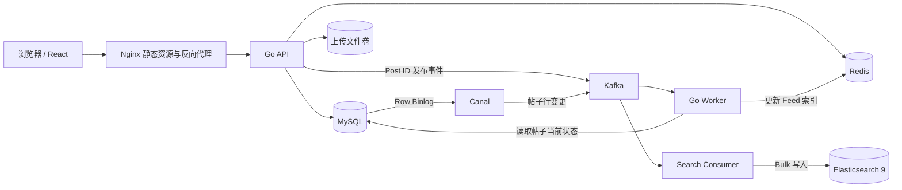

# Social Feed

一个完整的社交帖子 Feed 项目，提供账号、发帖、关注、互动、消息、热门内容与帖子全文搜索。项目采用前后端分离架构，并通过 Docker Compose 一键启动完整运行环境。

## 核心功能

- 账号注册、登录和个人资料管理
- 帖子发布、删除、图片上传与个人主页
- 关注、取关、关注列表与粉丝列表
- 关注流与热门流
- 点赞、收藏、评论与站内消息
- 基于 Elasticsearch 的帖子正文搜索
- JWT 认证、接口幂等与 Prometheus 指标

关注流采用推拉结合的分发方式：普通作者发布帖子后，由 Worker 异步推送到粉丝的 Redis Inbox；粉丝量较大的作者只写入自己的 Outbox，用户读取关注流时再合并 Inbox 与所关注大 V 的 Outbox。这样既保证普通关系链的读取效率，也避免大 V 发帖时产生过大的瞬时写入压力。

## 技术栈

| 层级 | 技术 |
| --- | --- |
| Web | React 18、Vite、Nginx |
| API | Go、Gin、GORM |
| 数据库 | MySQL 8.4 |
| 缓存与 Feed 索引 | Redis 7.4 |
| 消息与数据变更 | Kafka 4.3、Canal 1.1 |
| 全文搜索 | Elasticsearch 9 |
| 部署 | Docker、Docker Compose |

## 系统架构



API 负责同步业务请求，MySQL 保存业务事实数据。新帖子发布后，API 只向 Kafka 发送 Post ID，由 Feed Worker 回查当前状态并更新 Redis Feed 索引；帖子正文、状态及删除变更由 Canal 监听 MySQL Binlog 后发送到 Kafka，Search Consumer 批量同步到 Elasticsearch 9。

## 快速启动

### 环境要求

- Docker
- Docker Compose v2

### 1. 准备配置

```bash
cp .env.example .env
```

本地体验可以直接使用示例配置。部署到可公开访问的环境前，至少需要修改 `.env` 中的 `JWT_SECRET`、`INTERNAL_TOKEN` 和 `MYSQL_PASSWORD`。

如果只想体验前端 Mock 数据，将以下配置改为：

```env
VITE_USE_MOCK=true
```

Vite 环境变量会在镜像构建时写入前端产物，修改后需要重新构建 Web 镜像。

### 2. 启动项目

```bash
docker compose up -d --build
```

该命令会启动 Web、API、Worker、MySQL、Redis、Kafka、Canal 和 Elasticsearch。

### 3. 检查状态

```bash
docker compose ps
```

可访问的本地地址：

| 服务 | 地址 |
| --- | --- |
| Web | http://localhost:5173 |
| API 健康检查 | http://localhost:8080/health |
| Elasticsearch | http://localhost:9200 |

### 4. 查看日志

```bash
docker compose logs -f api worker web
```

### 5. 停止项目

```bash
docker compose down
```

如需同时删除本地数据库、缓存、消息队列、搜索索引和上传文件，请明确执行：

```bash
docker compose down -v
```
