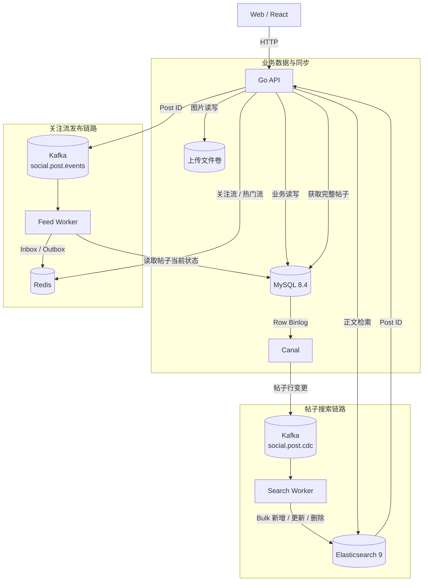

# Social Feed

Social Feed 是一个前后端分离的社交信息流项目，围绕帖子提供账号、关系、互动、消息、关注流、热门流和正文搜索。MySQL 保存业务数据，Redis 保存 Feed 索引，Kafka 负责传递异步消息。Canal 监听 MySQL Binlog，并将帖子变化同步到 Elasticsearch。整个项目可以通过 Docker Compose 启动。

## 核心功能

- 账号注册、登录和个人资料管理
- 帖子发布、删除、图片上传与个人主页
- 关注、取关、关注列表与粉丝列表
- 关注流与热门流
- 点赞、收藏、评论与站内消息
- 基于 Elasticsearch 的帖子正文搜索
- JWT 认证、接口幂等与 Prometheus 指标

关注流采用推拉结合的分发方式。普通作者发布帖子后，Feed Worker 会异步写入粉丝的 Redis Inbox。粉丝量较大的作者只写入自己的 Outbox，等用户读取关注流时，再合并 Inbox 和已关注大 V 的 Outbox。发帖事件只传递 Post ID，Worker 消费消息时会重新读取帖子当前状态，避免使用已经过期的作者和发布时间数据。

帖子搜索索引不依赖业务发帖消息。Canal 监听 MySQL Row Binlog，把帖子的新增、正文更新、状态变化和删除记录写入 Kafka。Search Worker 批量消费这些 CDC 消息，再同步到 Elasticsearch。搜索结果先按正文相关度排序，相关度相同时按发布时间排序。拿到 Post ID 后，API 会回到 MySQL 获取完整的帖子信息。

## 技术栈

| 层级 | 技术 |
| --- | --- |
| Web | React 18、Vite、Nginx |
| API | Go、Gin、GORM |
| 数据库 | MySQL 8.4 |
| 缓存与 Feed 索引 | Redis 7.4 |
| 消息与数据变更 | Kafka 4.3、Canal 1.1 |
| 全文搜索 | Elasticsearch 9 |
| 部署 | Docker、Docker Compose |

## 系统架构



Feed 和搜索使用两个独立的 Kafka Topic。`social.post.events` 只传递新帖的 Post ID，用于 Feed 分发。`social.post.cdc` 接收 Canal 生成的帖子行变更，用来维护 Elasticsearch 索引。两个 Topic 各自服务一条链路。帖子被隐藏或删除后，对应的 CDC 消息也会把它从搜索索引中移除。

## 快速启动

### 环境要求

- Docker
- Docker Compose v2

### 1. 准备配置

```bash
cp .env.example .env
```

本地体验可以直接使用示例配置。部署到可公开访问的环境前，至少需要修改 `.env` 中的 `JWT_SECRET`、`INTERNAL_TOKEN` 和 `MYSQL_PASSWORD`。

如果只想体验前端 Mock 数据，将以下配置改为：

```env
VITE_USE_MOCK=true
```

Vite 环境变量会在镜像构建时写入前端产物，修改后需要重新构建 Web 镜像。

### 2. 启动项目

```bash
docker compose up -d --build
```

该命令会启动 Web、API、Worker、MySQL、Redis、Kafka、Canal 和 Elasticsearch。

### 3. 检查状态

```bash
docker compose ps
```

可访问的本地地址：

| 服务 | 地址 |
| --- | --- |
| Web | http://localhost:5173 |
| API 健康检查 | http://localhost:8080/health |
| Elasticsearch | http://localhost:9200 |

### 4. 查看日志

```bash
docker compose logs -f api worker web
```

### 5. 停止项目

```bash
docker compose down
```

如需同时删除本地数据库、缓存、消息队列、搜索索引和上传文件，请明确执行：

```bash
docker compose down -v
```
